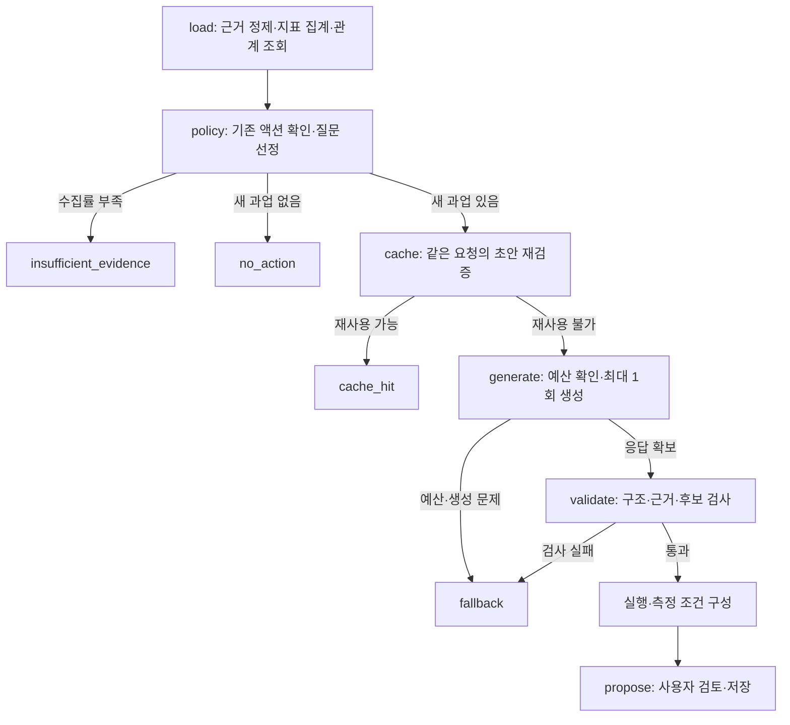

# VIVI Action Workspace

AI 검색 응답을 분석해 개선할 문제를 찾고, 그 문제를 풀 액션 후보 3개를 비교해 다음 작업 하나를 추천한다  
추천 근거와 후보를 고른 이유, 제외한 이유를 함께 보여준다  
담당 역할과 작업 초안, 완료 조건, 측정 범위도 제공한다

업무 로직은 LangGraph 에이전트에 있다  
FastAPI와 React는 조회·검토·저장·상태 변경을 맡는다  
기본 요청에서는 모델을 최대 1회 호출하며, 자동으로 재시도하거나 초안을 다시 쓰게 하지 않는다

## 실행

`.env.example`을 참고해 `.env`에 키를 설정한다  
검증한 설정은 OpenRouter `openai/gpt-5.4`, `VIVI_REASONING_EFFORT=low`다

```sh
docker compose up --build -d web
# http://localhost:8000
docker compose down
# 저장된 액션을 보존하려면 -v 옵션을 사용하지 않는다.
```

키 없이도 데이터를 조회하고 액션을 저장하거나 상태를 바꿀 수 있다  
새 초안을 요청하면 키가 없다는 이유와 함께 fallback을 반환한다  
`.env`와 로컬 상태는 Git·Docker 이미지에서 제외한다  
OpenAI를 직접 호출하려면 `VIVI_PROVIDER=openai`, `OPENAI_API_KEY`, `VIVI_MODEL`을 설정한다

로컬 개발:

```sh
uv sync --frozen
npm ci --prefix frontend
npm run build --prefix frontend
uv run uvicorn vivi_agent.api:app --host 127.0.0.1 --port 8000
```

주제 선택 → 근거 확인 → 초안 생성 → 후보·작업·측정 조건 검토 → 저장 → 진행 상태 변경 순서로 사용한다

## 에이전트가 액션을 고르는 과정

운영 진입점은 [ProductAgent](src/vivi_agent/product.py)다  
먼저 코드가 풀어야 할 질문 하나를 정하고, LLM이 그 질문에 맞는 액션을 비교해 고른다  
생성 결과는 코드로 검증한 뒤 사람이 검토할 초안으로 반환한다



### 먼저 풀 문제 선정

질문·채널별 응답을 정제하고 DuckDB로 언급·추천·인용 지표를 집계한다  
LatticeDB에서는 질문과 응답, 출처, 브랜드가 어떻게 연결되는지 조회한다  
지표와 관계 정보는 같은 데이터 버전을 사용한다

질문 우선순위는 `질문 중요도 × 추천 공백 × 유효 수집률`로 계산한다  
추천 공백은 유효 응답 중 자사가 추천되지 않은 비율이다  
초안이 있거나 진행 중인 질문, 같은 데이터 버전에서 이미 완료한 질문은 제외하고 점수가 가장 높은 질문을 고른다  
이 점수는 어떤 문제를 먼저 다룰지 정하는 기준이며, 예상 매출이나 액션의 성공 확률은 아니다

다음 경우에는 모델을 호출하지 않는다

- 주제의 유효 수집률이 80% 미만이면 `insufficient_evidence`를 반환하고 누락된 질문·채널의 재수집을 안내한다
- 모든 유효 응답에서 자사가 추천되거나 새로 할 과업이 없으면 `no_action`을 반환한다
- 같은 요청의 초안이 캐시에 있고 현재 검증을 통과하면 `cache_hit`으로 재사용한다

### 같은 문제의 액션 후보 비교

새 생성이 필요하면 과제 단가와 실제 USD 예산을 각각 확인하고 호출 비용을 예약한다  
그다음 LLM을 한 번 호출해 `CompactDraft`를 받는다

LLM은 선택된 질문 하나에 대해 서로 다른 방식의 후보 3개를 비교한다  
후보 유형은 기존 자산 검토·개정, 신규 제작, 기능·작업 경로 확인, 제품 변경, 관찰이다  
다른 질문의 우선순위를 나열하는 것으로 액션 후보 비교를 대신하지 않는다

각 후보에는 다음 판단을 담는다

- 관측한 문제와 액션을 연결하는 근거, 기대 이점과 효과 가설
- 필요한 노력과 그 가정, 실행 가능 여부와 선행 조건
- 위험과 다른 후보 대비 선정·보류·배제 이유

하나를 선정한 뒤에는 선택을 바꿀 조건도 남긴다  
선정한 작업에는 담당 역할, 작업 단계, 편집 가능한 산출물 초안과 완료 조건을 붙인다  
효과 가설은 검증된 성과와 구분하고, 근거 없는 매출·개선율을 쓰지 않도록 지시한다

### 초안 검증과 실행 조건

코드는 `CompactDraft`를 `ProductPlan`으로 확장하면서 근거 ID와 질문 범위, 후보 간 일관성을 검사한다  
선정 후보는 하나여야 하고 실제 작업의 제목·방식과 맞아야 한다  
실행이 막힌 후보를 고르거나 근거에 없는 ID를 쓰면 통과하지 못한다  
확인이 필요한 선행 조건은 실행안에 남기고 준비 상태에도 반영한다

자산 선정과 게시 절차는 공통 규칙에 따라 코드가 붙인다

- 기존 자산을 재사용하려면 모든 후보에 같은 필수 기준을 적용해 본문을 확인한다
- 검사하지 않은 후보가 남으면 선정을 보류하고, 모두 검사했는데 통과한 후보가 없을 때 신규 제작한다
- 참고용 출처는 편집 대상으로 취급하지 않는다
- 공개 원고의 미확인 주장은 확인하거나 삭제하고, 확인되지 않은 필수 정보가 남으면 게시를 보류한다

이 절차는 작업자가 수행할 조건을 정한 것이며, 에이전트가 실제 본문을 확인하거나 게시했다는 뜻은 아니다  
생성 지침에는 미지원 기능을 지원한다고 쓰거나 미확인 연동 경로를 만들어내지 않도록 명시했다

구조·근거 검사를 통과하면 `propose`로 초안을 반환한다  
키 미설정, 예산 부족, 이전 시도 제한, 생성·검증 오류는 `fallback`으로 처리한다  
실패한 초안을 고치려고 모델을 다시 호출하지 않으며, 실패 비용도 원장에 남긴다  
코드 검사만으로 문장의 모든 오류나 전략의 타당성을 판단할 수는 없어, 사용자가 제품 사실과 실행 가능성을 검토한 뒤 저장하고 진행 상태를 바꾼다

### 후속 측정

주요 성과 지표는 같은 질문·채널 범위의 자사 언급·추천이며, 출처 인용은 보조 지표로 쓴다  
게시 액션의 후속 수집은 확정 URL, 해당 URL의 자사 source ID, 게시 시각을 모두 기록한 뒤 시작하도록 정한다  
측정 계획은 게시 후 7일·14일에 같은 질문·채널을 비교하도록 구성하고, 실패·부분 응답·결측을 미언급 0으로 바꾸지 않는다  
분모가 맞지 않으면 비교를 유보하며, 보조 지표만 좋아진 것을 성공으로 보지 않는다

내부 검증 작업은 작업 결과와 완료 조건으로 판단하고 게시 후 성과 측정을 붙이지 않는다  
현재 노출 수치는 참고 기준선으로만 보여준다

## 저장소와 API

| 저장소 | 용도 |
| --- | --- |
| DuckDB | 정제된 응답의 지표 집계 |
| LatticeDB | 질문·응답·출처·브랜드 관계 조회 |
| SQLite | 사용자 액션·상태, 과제 단가·실제 비용 원장 |
| JSON / JSONL | 정확한 결과 캐시, 실행·변경 이력 |

API는 `GET /api/topics`, `GET /api/topics/{topic_id}`, `POST /api/proposals`, `GET/POST /api/actions`, `PATCH /api/actions/{id}`로 구성된다  
고객은 서버의 `VIVI_CUSTOMER_ID`로 고정한다  
로컬에서 한 고객을 대상으로 쓰는 MVP이며, 인증과 조직 관리는 구현하지 않았다

## 비용과 검증

모델 입력의 중복을 없애고 생성 계약을 줄였으며 추론 수준도 낮췄다  
같은 네 사례에서 평균 실제 비용이 $0.1858에서 $0.1024로 44.9% 줄었고, 내용 평가도 기존 수준 이상을 유지했다  
더 저렴한 mini·무추론 설정은 제품 사실과 실행 절차에 오류가 남아 제외했다

기본 최대 1회를 유지하며 정확한 캐시·근거 부족·기존 과업 중복은 0회 처리한다  
캐시를 재사용할 때는 고객·데이터·맥락·현재 액션·모델 설정·스키마·구현 버전이 일치하는지 확인한다  
과제의 고정 단가 M $0.018과 공급사의 실제 USD 비용은 별도 원장으로 제한한다

월 $100 구독·1,000건 추천·마진 80% 조건은 아직 충족하지 못했다  
현재 실측 평균을 적용하면 평균월 98건 이하만 새로 생성하고, 나머지 902건은 유효한 캐시나 정당한 0회 판단이어야 한다  
이 재사용률은 검증되지 않았으며, 예산 초과 fallback을 같은 품질의 추천으로 세지 않는다

비용 비교 20회에 총 $1.14256725가 들었고 Langfuse 기록과 20/20 일치했다  
[비용·품질 결과](docs/cost-optimization-results.md)에 실패한 설정과 과제 계산, 실제 요금, 남은 편집 항목을 기록했다

```sh
uv run pytest -q
npm run build --prefix frontend
```

테스트 473개와 하위 테스트 18개가 통과했다  
제공된 합성 데이터에 실제 모델을 호출해 검증했으며, 실제 제품 연동·게시·노출 개선은 수행하지 않았다  
모든 추천은 사람이 제품 사실과 실행 가능성을 확인할 초안이다

## Langfuse

```sh
python3 scripts/setup_langfuse.py
docker compose -f compose.langfuse.yaml up -d --wait --wait-timeout 300
docker compose -f compose.yaml -f compose.observability.yaml up --build -d web
# 앱: http://localhost:8000 / 관측: http://localhost:3000
```

호출별 모델·토큰·상태·지연·실제 비용을 기록한다  
프롬프트·응답 본문·키는 보내지 않는다  
생성에 실패해도 비용에 포함하며, 관측 장애가 나더라도 모델을 다시 부르지 않는다  
Langfuse의 월 인프라 비용은 아직 실측하지 않았다  
설정과 확인 방법은 [설치와 비용 대사](docs/langfuse.md)에 정리했다

## 문서

- [코드 탐색 wiki](llm-wiki/index.md): 모듈 책임, 수정 지점, 영역별 `index.yaml`
- [에이전트 설계](docs/agent-design.md): 후보 선정, 실행·측정 계약, 비용 예약과 한계
- [비용 절감 결과](docs/cost-optimization-results.md): 채택 설정과 제외한 설정의 실제 비교
- [이전 1회 경로 검증](docs/product-v2-validation.md): 세 실패 사례의 수정 이력
- [Jev 검토](docs/jev-integration.md): 별도 평가 경로의 설계이며 기본 1회 흐름에는 추가 평가 호출이 없다

`--deep-review`로 실행하는 기존 다중 호출 CLI는 별도 실험 경로다  
운영 1회 경로의 비용·품질과 합산해 설명하지 않는다
