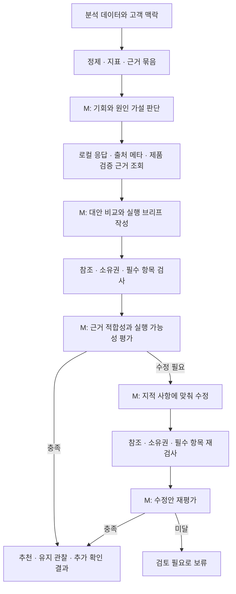

# 분석을 실행 가능한 개선 액션으로 연결하는 에이전트

초기 CLI·다중 호출 경로의 설계 기록이다. 현재 앱의 기본 경로는 [에이전트 설계](agent-design.md)를 참고한다.

이 에이전트의 책임은 **분석 데이터에서 개선 기회를 찾고, 고객이 실행할 수 있는 작업 명세로 바꾸는 것**이다. 최종 산출물은 선택 이유, 실제로 변경할 대상, 작업 내용과 초안, 완료 조건, 효과 확인 방법을 갖춘 액션 브리프다. 현재 진입점은 CLI이며 결과 JSON, 근거 묶음, 그래프 체크포인트와 호출 원장을 저장한다.

현재 구현은 `EvidenceRepository.build/lookup`과 `AgentRunner`의 LangGraph에 있다. 이 문서의 마지막 액션 예시는 설계 단계에 작성한 예시이며, 실행 결과와 구분한다. 실제 모델 실행 결과는 `output/`에 있고, 평가 결과와 실패 기록은 [에이전트 검증 보고서](agent-validation.md)에서 정리한다. UI, HTTP API, 게시 기능과 액션 업무 상태 관리는 현재 구현 범위에 포함되지 않는다.

## 좋은 액션의 기준

“리드 관리 콘텐츠를 보강하세요”는 작업 명세가 부족하다. “기존 리드 스코어링 가이드를 검토하고 웹 문의 등록·중복 처리·담당자 인계의 실습 절을 추가하되, 제품에서 검증된 경로만 설명한다”는 수정 대상과 수행 방법을 갖춘 후보가 된다. 여기에 입력 예제·기능 확인표·완료 조건·측정 계획까지 있어야 사용자에게 넘길 수 있다.

| 판단 기준 | 에이전트가 답해야 하는 질문 |
| --- | --- |
| 근거 | 어떤 질문·채널·응답·인용이 이 작업을 뒷받침하는가? |
| 변화의 이유 | 이 작업이 어떤 정보 부족 또는 설명상의 불일치를 해소할 것으로 보는가? 반대 근거는 있는가? |
| 실행 가능성 | 누가 통제할 수 있는 대상을, 어떤 준비물로 바꾸는가? 미확인 사실은 무엇인가? |
| 구체성 | 어떤 산출물을 만들어야 하는가? 내용·예제·작업 순서·완료 조건이 있는가? |
| 검증 가능성 | 제작 완료와 가시성 변화는 각각 어떻게 확인하는가? |

큰 노출 격차는 조사할 이유이지 특정 처방이 맞다는 증거는 아니다. 에이전트는 후보를 비교하고, 해당 상황에서 이 작업을 먼저 할 이유를 설명한다.

## 필요한 입력

분석용 입력은 질문과 검색 의도, 정제된 채널별 관측, 언급·추천 맥락, 인용 출처, 비교 가능한 이전 시점이다. 각 사실에 원본 ID를 붙이고, 제외 관측과 분모를 함께 제공한다.

고객 맥락은 목표 고객, 사업 목표, 확인된 제품 기능, 보유 콘텐츠, 담당 역할과 제약이다. 제공 자료에서 확인되는 OrbitCRM 설명은 “중소기업을 위한 CRM·영업 자동화 솔루션”이고, 출처 메타데이터에서 문서의 제목·URL을 확인할 수 있다. 세부 기능, 실제 문서 본문, 운영 인력은 확인되지 않았다.

고객 맥락에서 모르는 값은 `unknown`으로 유지한다. 에이전트는 준비 가능한 초안과 확인이 필요한 실행 조건을 함께 제시한다. 기능이 확인되지 않았다는 이유만으로 모든 작업을 “조사 필요” 한 줄로 끝내지 않는다. 예를 들어 문서 목차와 입력 예제는 준비할 수 있고, 기능 지원 주장과 게시 여부는 제품 담당자의 확인을 기다린다.

AI 응답 속 제품 기능 설명은 검색 결과의 진술이다. 이를 검증된 제품 사양으로 사용하지 않는다. 보유 출처의 제목도 실제 본문을 읽었다는 근거가 될 수 없다.

고객이 제공한 제품 검증 사실은 `verified_product_facts`에 진술과 `receipt_id`, 출처를 함께 보존한다. 계약에 정의된 명시적 기능 지원 boolean과 `evidence_receipt`가 함께 제공되면 해당 기능만 검증 사실로 정규화하고 `partially_verified`로 표시한다. 확인된 연동 경로를 네이티브 지원으로 바꾸거나 다른 기능·체험 조건까지 확인된 것으로 확장하지 않는다.

## LangGraph 판단 흐름



위 그림은 새 분석의 판단 경로다. 캐시와 월 예산, 노드 실패 처리는 이 경로를 감싼다. 액션 구조 검사에서 탈락한 후보는 수정 경로로 보낼 수 있다. 통신 실패와 수정은 같은 호출 한도를 사용한다.

### 근거를 구성하는 코드

구현의 `EvidenceRepository.build`는 대상 주제의 모든 유효 질문·채널과 이전 비교 쌍, 자사·경쟁사 추천 비율, 소유 출처를 인용한 응답 비율과 출처 분포를 준비한다. 같은 응답이 한 브랜드의 여러 출처를 인용해도 브랜드별 인용 응답 수에는 한 번만 포함한다.

`EvidenceRepository.lookup`은 근거 묶음에 포함된 질문, 관측 원문, 언급, 인용, 출처 메타데이터, 지표와 고객이 제공한 제품 검증 receipt를 ID로 조회한다. 제품 검증 receipt의 출처를 보존하며 데이터셋 ID와 충돌하면 거부한다. 범위 밖 ID는 조회할 수 없다. 외부 웹 검색·본문 수집·기존 액션 조회 도구는 구현돼 있지 않으며, `body_access=false`를 모델에 전달한다. `.example` 출처를 실제 크롤링한 것으로 취급하지 않는다.

모델 호출 전에 근거 ID, 지표 ID, 질문 ID를 JSON Schema의 enum으로 제한한다. 수정할 기존 자산의 source ID는 명시적으로 자사 소유인 출처만 허용한다. 생성 후에도 참조 범위·유형·소유권과 출력 필수 항목을 코드로 검사한다. enum과 구조 검사를 통과해도 문장의 의미가 근거와 일치하는지는 별도 검토가 필요하다.

### 첫 모델 호출에서 판단할 것

`diagnose` 노드는 다음을 구조화한다.

- 해결할 고객 질문과 의도, 약한 채널, 범위와 중요성.
- 관측 사실, 가능한 원인, 반대 근거, 대안 설명.
- 콘텐츠의 어떤 정보가 답변에 도움이 될 수 있는지에 대한 가설.
- 판단을 위해 추가로 읽어야 할 로컬 근거와 확인되지 않은 사실.
- `recommend`, `observe`, `needs_data` 중 판단 방향과 그 범위.

예를 들어 “자사 문서 없음”과 “자사 문서는 인용되지만 브랜드 추천으로 이어지지 않음”을 구별해야 한다. 수집 실패를 실제 미언급으로 해석하는 진단은 제외한다. 다음 초기 제품 규칙을 `allowed_decisions`로 모델 생성 스키마와 생성 후 검증에 동일하게 적용한다.

- 유효 관측 coverage가 80% 미만이면 `needs_data`만 허용한다. superseded 중복을 제외한 모든 제외 질문·채널 쌍의 재수집 작업이 필요하다.
- coverage가 80% 이상이고 유효 응답의 자사 추천 비율이 100%이며 분모가 양수이면 `observe`만 허용한다.
- 그 외에는 모델이 `recommend`, `observe`, `needs_data` 중 판단한다.

이는 데이터가 부족한 상태에서 처방하거나 이미 추천되는 범위에 불필요한 작업을 만드는 일을 줄이기 위한 초기 제품 규칙이다. 80%를 통계적 신뢰도로 해석하지 않는다. 강제된 `observe`·`needs_data` 분기에서는 생성 스키마의 액션 수를 0개로 제한한다.

진단 사실에 `metric_ids`가 있으면 `render_metric_facts`가 해당 진술을 코드가 계산한 지표 ID·분자·분모·정의로 렌더링한 뒤 설계 단계와 최종 결과에 전달한다. 모델의 원래 정량 문장은 호출 기록에 남긴다. 정성적 관측과 원인 가설의 적합성은 계속 의미 검토 대상이다.

첫 호출에서 요청한 로컬 근거 조회는 허용된 읽기 도구로 제한하고, 조회 결과를 두 번째 호출에 전달한다. 대상 주제 범위 안에서 수행하므로 별도의 임베딩·웹 검색 호출은 기본 경로에 없다.

### 두 번째 모델 호출에서 만들 것

`design` 노드는 다른 개입 방식을 비교하고 **최종 액션을 최대 1개** 선택한다. 선택하지 않은 대안과 이유는 `rejected_alternatives`에 남긴다. 예를 들어 기존 가이드 개정, 별도 실습 문서, 비교 페이지는 서로 다른 작업이다. 제목만 바꾼 중복 후보를 대안으로 세지 않는다.

선택한 액션에는 목적·근거·예상 작동 원리·대상 자산·담당 역할·산출물 초안·작업 단계·선행 조건·완료 조건·효과 확인 방법을 넣는다. 선택 이유에는 관련 질문의 중요도, 관측의 반복성, 수정 가능한 자산의 존재, 노력과 불확실성을 설명한다. 매출 상승이나 노출 상승률을 근거 없이 예측하지 않는다.

`observe`는 유지할 대상과 재검토 조건을, `needs_data`는 실제 제외된 질문·채널의 재수집 이유와 완료 조건을 낸다. 제품 기능이나 문서 본문 확인은 재수집 작업과 구분해 액션의 선행 조건·단계에 기록한다. 확인이 필요한 액션은 `needs_input` 또는 `blocked`로 표시한다.

### 세 번째 모델 호출에서 검토할 것

`review` 노드에는 근거 묶음, 고객 맥락, 후보를 전달한다. 후보 작성자의 자기평가 점수는 입력에서 제외한다. 검토자는 좋은 문장인지보다 실제 근거에서 해당 처방이 도출되는지, 담당자가 추가 기획 없이 착수할 수 있는지 평가한다.

같은 모델을 다른 호출에서 사용해도 오류가 독립적이라고 가정하지 않는다. 검토 모델의 판단 역시 코드 검사와 사람의 오프라인 평가 대상이다.

검토는 아래 5항목을 각각 0~2점으로 평가하고, 점수의 이유와 관련 출력 필드를 기록한다.

| 항목 | 0점 | 1점 | 2점 |
| --- | --- | --- | --- |
| 근거 적합성 | 모순·날조·잘못된 범위 | 근거는 있으나 연결이 약함 | 사실과 가설을 구분하고 반대 근거도 반영 |
| 문제와 처방의 연결 | 상황과 관계없는 작업 | 연결은 있으나 대안 비교 부족 | 해당 질문·상황에 맞는 처방과 선택 이유 |
| 구체성 | 추상적인 권고 | 작업은 알 수 있으나 산출물 불완전 | 대상·작업 내용·초안·완료 조건이 명확 |
| 실행 가능성 | 미확인 기능을 사실로 사용하거나 실행 불가 | 의존 조건 일부 누락 | 통제 가능한 작업과 선행 확인·역할 명확 |
| 효과 확인 | 완료와 성과를 혼동 | 지표 또는 기준점 누락 | 완료 확인과 비교 가능한 후속 측정 분리 |

초기 통과 정책은 `approve`, 합계 8/10 이상, 모든 항목 1점 이상, 필수 위반과 남은 이슈 0건이다. 미확인 제품 주장을 사실로 사용한 `claim_checks`가 있으면 통과하지 못한다. 검토자가 제품 사실을 검증됐다고 표시할 때는 고객 맥락에 실제 등록된 receipt를 참조해야 한다. 점수는 선택 규칙이며 성공 확률이 아니다. 필수 위반은 존재하지 않는 근거, 틀린 집계, 근거 없는 제품 기능·인과 단정, 게시를 막는 선행 조건 누락이다.

### 수정과 종료

의미 검토에서 탈락하면 `revise → re_review`를 한 번 더 실행할 수 있다. 수정된 후보에도 다시 구조·근거 검사와 의미 검토가 필요하다. 검토하지 않은 수정안을 통과 결과로 반환하지 않는다.

기본 3회, 수정·재검토를 포함해 분석 키당 유료 모델 시도는 최대 5회다. 통신 오류와 재개도 이 한도를 공유한다. 수정·재검토에는 남은 두 번의 호출 예산을 함께 예약한다. 예산이 부족하거나 두 번째 검토도 실패하면 `review_required`로 반환하며 검증된 추천으로 집계하지 않는다.

## 출력 계약

```text
AgentResult
  run_id, scope, model, prompt_version, cache_hit
  status, decision, diagnosis, plan, review
  validation_errors, review_errors, execution_error, events
  evidence_quality, metrics, evidence_path, usage

ActionPlan
  decision, summary
  actions: ActionBrief[] (최대 1개)
  rejected_alternatives, monitoring_plan, data_tasks, limitations

ActionBrief
  title, action_type
  question_ids, channels, evidence_ids
  opportunity: 해결할 문제와 지금 다룰 이유
  mechanism_hypothesis: 예상 작동 원리와 불확실성
  target_asset: 기존 자산 / 제안 자산 / 확인 후 선택
  owner_role: 제안 역할, 실제 담당자 지정과 구분
  deliverables: 산출물 내용·목차·예제·초안
  steps: 순서별 작업과 산출물
  prerequisites: 필요한 선행 확인
  acceptance_criteria: 제작 완료 기준
  measurement: 기준점 지표 ID, 후속 측정, 긍정적 신호, 중단·수정 조건
  priority_reason, effort_assumptions
  readiness: ready_to_start | needs_input | blocked
```

결과에는 선택한 액션뿐 아니라 기각한 대안과 이유를 짧게 포함한다. 모델 추론의 내부 기록 대신 판단에 필요한 관측 근거와 설명을 제공한다.

캐시 키에는 범위, 데이터셋 해시, 정규화된 고객 맥락의 `context_hash`, 모델, 프롬프트 버전과 핵심 코드 해시를 넣는다. 제품 확인 근거가 바뀌면 별도 분석 키가 만들어진다. 실행 결과 JSON의 재사용, LangGraph 체크포인트와 호출 원장 기반 재개가 구현돼 있다. 게시된 액션의 상태 조회·변경, 담당자 배정, 다른 실행에서 만든 액션과의 중복 관리는 아직 구현하지 않았다.

## 목표 출력의 실제 데이터 예시

**액션: 웹 문의 등록부터 담당자 인계까지 재현할 수 있는 OrbitCRM 실습 가이드 제작.**

Q068의 최신 세 응답 OBS0406·OBS0407·OBS0408은 모두 정상 수집됐으며 자사를 언급하지 않는다. Perplexity의 리드 관리 5개 응답에는 경쟁사의 SRC025 “LeadFlow 리드 자동 배정 사례”가 반복 인용된다. 한편 자사 SRC022 “OrbitCRM 리드 스코어링 가이드”도 존재하는 것으로 메타데이터에 기록돼 있다.

가능한 개선 가설은 고객이 묻는 문의 등록·중복 처리·담당자 인계를 검증된 제품 사용 절차와 연결해 설명하는 것이다. 현재 가이드에 이 내용이 없다고 단정하지 않는다. 실제 본문 확인 후 기존 가이드를 개정하거나 별도 실습 문서를 만들어 연결한다.

산출물은 다음 세 개다.

1. **실습 가이드:** 적용 대상·준비물 → 문의 필드 매핑 → 중복·실패 처리 → 우선순위·담당자 인계 → 동작 확인 → 검증된 체험 또는 상담 경로.
2. **예제 입력·결과 표:** 신규 문의, 같은 이메일의 재문의, 필수값 누락 문의의 세 사례. 예시 필드는 email·company·inquiry_type·source_url·received_at이며 실제 제품 필드로 확인 후 매핑한다.
3. **기능 근거표:** 문의 수신·중복 처리·담당자 배정·스코어링·요금제·체험 조건의 지원 여부, 검증 근거, 제약, 확인자.

콘텐츠 담당자는 목차·예제·확인표를 먼저 준비할 수 있다. 제품 담당자는 실제 지원 경로를 확인한다. 네이티브 또는 공식 연동 자동화가 있으면 재현한 절차를 쓰고, 없으면 자동화 해법으로 홍보하지 않으며 확인된 수동 경로와 제품 요청을 분리한다.

제안하는 업무 완료 조건은 기능 주장에 검증 근거가 있고, 세 예제에 실제 결과·기대 결과·실패 조치가 있으며, 운영자가 산출물 URL과 게시일을 기록하는 것이다. 현재 CLI는 이 작업 명세를 JSON으로 저장하며 실제 게시나 업무 완료 상태를 처리하지 않는다. 담당 역할도 제안이며 실제 사람이 배정된 상태는 아니다.

효과 확인은 Q068 자사 언급 0/3과 Perplexity 리드 관리 언급 0/5를 기준으로, 게시 후 다음 두 번의 주간 수집에서 동일 질문·채널의 유효 관측을 비교한다. 문서 인용, 브랜드 추천, 추천 순위를 따로 본다. 새로운 인용·추천이 다음 회차에도 이어지면 긍정적 신호로 기록하되 인과적 효과를 입증한 것으로 처리하지 않는다.

상세 구조 예시는 [리드 관리 액션 브리프](examples/lead-action-brief.json)에 있다. 이 예시도 에이전트의 실제 실행 결과가 아니다.

## 실행 평가와 비용 기록

[평가 사례](../evals/action-cases.json)는 좋은 기회, 이미 잘하는 주제, 데이터 부족, 기존 자산을 무시한 처방, 미지원 기능, 추상적인 액션, 잘못된 근거, 기능 확인 후 달라져야 하는 처방의 8개 사례다. 정답을 특정 제목으로 고정하지 않고 필수 판단과 금지된 주장으로 정의한다.

8개 사례에 대한 실제 모델 평가 실행은 완료됐으며, 실행별 통과·실패와 후속 수정 결과는 [에이전트 검증 보고서](agent-validation.md) 및 원본 `output/evaluation*.json`에 정리한다. 초기 목표는 8개 중 7개 이상 기대 판단 충족, 필수 위반 0건이다. 평가 완료와 목표 달성을 구분하며, 보고서에서 해당 실행의 결과와 코드 버전을 확인한다. 평가 모델은 생성 모델과 오류를 공유할 수 있고, 사례 통과가 사람의 액션 채택률이나 실제 사업 성과를 입증하지는 않는다. Mock은 그래프 분기와 출력 계약 검사에 사용한다.

호출 원장은 실제 실행의 시도·완료·실패·예약을 기록하며, 평가 산출물은 과제의 고정 단가로 환산한 비용을 함께 제공한다. 이 값은 실제 공급사 청구액과 구분한다. 월 원가와 마진은 [비용 계산 결과](cost-projection.json)의 수집 주기·재사용·호출 수 가정에 따른 시나리오다. 검토 호출 자체의 인과적 품질 개선이나 두 호출 대비 세 호출 구조의 우월성을 측정한 것으로 주장하지 않는다.
