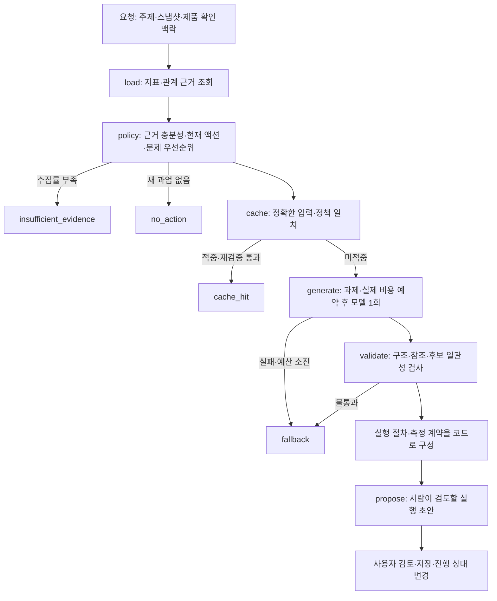

# VIVI 에이전트 설계

목적은 분석 결과를 설명하는 데서 끝내지 않고 **지금 실행할 개선 액션 한 가지를 선택하는 것**이다. 기본 요청은 LLM 최대 1회다. 같은 문제를 푸는 서로 다른 후보를 비교하고, 선택한 후보를 담당자·작업 단계·산출물 초안·완료 조건·후속 측정으로 구체화한다.

## 문제 선택과 액션 선택

두 판단을 분리한다.

1. **어느 문제를 먼저 풀지**는 코드가 정한다. 유효한 질문·채널 응답을 기준으로 `질문 중요도 × 추천 공백 × 수집률`을 계산한다. 진행 중인 과업과 같은 데이터 버전에서 완료한 과업은 제외한다. 이 점수는 기대 매출이나 액션 성공 확률이 아니다.
2. **그 문제를 어떤 작업으로 풀지**는 모델이 고른다. 같은 질문에 대해 기존 자산 검토·개정, 신규 제작, 기능·작업 경로 확인, 제품 변경, 관찰 중 서로 다른 개입 방식 3개를 비교한다. 효과가 생길 수 있는 이유, 근거, 노력과 그 가정, 실행 조건, 위험, 선정·보류·배제 이유를 작성한다. 선정이 뒤집힐 조건도 남긴다.

따라서 다른 질문의 낮은 점수를 보여주는 것을 ‘액션 후보 비교’로 대체하지 않는다. 모델이 제시한 효과는 관측 데이터로 뒷받침된 가설이며 실험으로 입증한 효과가 아니다.

## LangGraph 실행 흐름

원장 예약이 모델 호출보다 먼저 일어난다. SDK 재시도는 꺼져 있으며 출력 검사에 실패해도 재작성 모델을 부르지 않는다. 실패한 첫 응답도 기록한다. 같은 요청을 다시 눌러 자동으로 추가 비용을 쓰는 경로는 열지 않는다. 캐시는 고객·데이터·맥락·현재 액션·모델·추론 수준·출력 한도·스키마·정책·구현이 모두 일치할 때만 사용한다.

## 모델과 코드가 맡는 부분

| 판단 또는 작업 | 담당 | 보장 범위 |
| --- | --- | --- |
| 수집 성공·결측·중복 정제, 분자·분모 집계 | 코드 | 제공 원본과 정제 정책의 일관성 |
| 질문 우선순위·기존 과업 중복 제외 | 코드 | 설명 가능한 초기 운영 규칙 |
| 같은 문제의 후보 비교·선정, 구체적 작업 초안 | 모델 1회 | 근거를 사용한 제안; 의미적 정답 보장 아님 |
| 소유 자산의 후보·보조·제외 분류 및 필수 재사용 기준 | 모델 | 메타데이터에 근거한 가설; 본문 열람 확인 아님 |
| 후보 ID·유형·선택 개수·제목·선행 조건 일치 | 코드 | 구조와 명시적 모순 차단 |
| 전체 자산 검사 후 선택, 게시 조건, 후속 수집 조건 | 코드 | 모든 결과에 같은 실행 규칙 적용 |
| 측정 질문·채널·분모·일정·결측 처리 | 코드 | 기준선과 후속 비교 범위 일치 |
| 실제 본문·기능 확인, 게시 승인과 실행 | 사람 | 현재 MVP가 대신 수행하지 않음 |

생성 스키마는 `CompactDraft`다. 모델은 후보 3개와 선정 이유, 자산별 관련성 판단, 실제 작업 초안, 완료 조건, 필요한 연동 검증만 출력한다. 코드가 이를 화면/API의 `ProductPlan → ActionSelection + ProductAction`으로 확장한다. 같은 제목·근거·노력·선행 조건을 후보와 액션에 두 번 생성하거나, 코드가 덮어쓸 측정·게시 문장을 생성하는 비용을 없앴다.

선정 후보와 실행 액션의 제목·방식이 일치해야 한다. 선행 조건은 원문을 보존한 채 실행안에 합치고, 미확인 조건이 있으면 실행 준비 상태를 낮춘다. 차단된 후보를 선택하거나 근거에 없는 ID를 참조하면 보류한다. 실제 작업 초안은 보존하며, 코드가 누락된 전략이나 본문을 대신 지어내지 않는다. 자산 선정표·게시 절차처럼 역할이 명시된 운영 부분만 코드로 생성한다. 원래 모델 응답도 별도로 보관한다. 자유 서술의 의미적 모순까지 코드가 완전히 판별하지는 못하므로 사용자 검토를 유지한다.

전송용 근거는 중복 관계, 반복 지표 설명, 상위 관측 ID를 되풀이하는 필드를 줄인다. 반복 레코드는 읽을 수 있는 `table_columns`와 행 배열로 보내 필드명을 한 번만 적는다. 원래 JSON으로 정확히 복원하는 검사를 두며, 행마다 필드 구성이 다르면 일반 객체 형태를 유지해 누락과 null을 구분한다. 다른 질문의 반례, 전체 소유 자산, 검증된 제품 사실과 false/unknown 상태는 유지한다. 실제 지표 계산과 검증은 압축 전 원본 근거를 사용한다.

## 세 실패를 막는 실행 계약

**보조 출처를 편집 대상으로 섞지 않는다.** 각 자사 출처를 `inspect_for_reuse`, `supporting_only`, `exclude_for_this_task`로 구분한다. 예를 들어 개인정보처리방침을 리드 등록 설명의 참고로 쓰더라도, 그것만으로 핵심 실습 문서의 개정·최종 인용 추적 대상이 되지 않는다.

**자산 선택은 같은 필수 조건을 모든 후보에 적용한다.** 후보 하나가 실패하면 그 후보를 제외하고 나머지를 계속 검사한다. 미확인 후보가 남으면 결정을 보류한다. 모두 검사한 뒤 통과 후보가 있으면 그중 한 건을 선정하고, 통과한 후보가 전혀 없을 때 신규 제작한다. 이 상태 전이는 코드로 고정되며 본문을 실제로 검사했다는 뜻은 아니다.

**게시와 측정의 시작 조건을 명확히 한다.** 미확인 주장은 근거로 확정하거나 공개 원고에서 삭제한다. 필수 정보가 남으면 게시를 보류한다. placeholder는 내부 초안에만 허용한다. 후속 수집은 최종 게시 URL **그리고** 해당 URL의 자사 `source_id`, 확정 게시 시각이 모두 등록돼야 시작한다. 후보 목록이나 등록 요청만으로 시작하지 않는다.

알려진 미지원 기능은 홍보하지 않는다. 검증된 연동 경로가 제공되면 그 경로와 검증 영수증을 유지하고, 임의의 UI·API·수동 대체 경로를 만들어내지 않는다. 내부 검증이나 제품 변경을 선정한 경우에는 게시 절차를 억지로 붙이지 않고 작업 결과와 검증 기록으로 완료 여부를 판단한다.

## 측정과 효과

리드 Q068·보안 Q026의 주요 범위는 각각 같은 질문의 3개 채널 응답 쌍이다. 보안 주제 전체 12쌍은 보조 범위로 분리한다. 주요 성과는 자사 언급·추천이며 자사 출처 인용은 보조 지표다. 인용만 늘었다고 성공으로 판정하지 않는다. 이들은 서로 다른 지표이며, 화면 요약의 수치는 모델 문장을 그대로 사용하지 않고 정제된 지표에서 만든다.

게시 액션의 후속 일정은 게시 후 7일·14일이다. failed·partial·결측을 미언급 0으로 치환하지 않는다. 주요 범위의 분모가 맞지 않으면 비교를 유보하고, 보조 범위만 좋아진 결과를 주요 액션의 성공으로 선언하지 않는다. 내부 작업은 노출 기준선을 참고 맥락으로만 표시한다.

현재 검증은 제공된 합성 데이터에서 실제 모델이 실행 가능한 초안을 만드는지 확인하는 것이다. 실제 제품 연동·문서 게시·후속 수집은 하지 않았으므로 전환율이나 노출 개선을 달성했다고 주장하지 않는다.

## 저장소와 관측

DuckDB는 정형 지표, LatticeDB는 질문→응답→출처→브랜드 관계를 조회한다. 두 결과는 동일한 원본 해시를 사용한다. SQLite는 사용자 액션·상태·호출 원장, JSON은 정확한 캐시, JSONL은 실행·사용자 변경 이력을 저장한다. FastAPI와 React는 입출력·검토·저장에 집중한다.

Langfuse는 별도 Docker 스택으로 올려 호출별 모델·토큰·지연·상태·비용을 관찰한다. 생성 단계에만 연결되며 추가 LLM 호출은 하지 않는다. 프롬프트·응답 본문·키는 관측 서버에 전송하지 않고, 허용한 식별자와 수치만 기록한다. 실제 공급사 응답의 비용과 과제 단가 $0.018/회를 분리한다. 공급사 비용이 없으면 미확인으로 남기고, Langfuse의 추정값을 실제 청구액으로 바꾸지 않는다. 관측 서버의 장애로 모델을 재호출하지 않는다. 이 스택의 실제 호스팅비는 아직 측정하지 않았으므로 기존 과제 인프라 $6 가정이 실측 원가를 보장하지 않는다.

Jev는 추후 후보별 원자적 품질 판단을 오프라인에서 비교할 확장 지점이다. 기본 1회 경로에 추가 판단 호출을 숨겨 넣지 않는다. 기존 [Jev 설계](jev-integration.md)의 다중 호출 검토 흐름은 별도 실험 경로이며 현재 운영 그래프가 아니다.

## 실제 비용 통제

과제의 고정 모델 단가 $0.018 원장과 공급사 실제 USD 원장을 별도로 둔다. 호출 전 고정 단가 한도와 실제 비용 한도를 모두 통과해야 한다. 실제 원장은 캐시 할인 없이 입력 바이트의 보수적 토큰 상한과 설정한 출력 토큰 상한, 확인한 모델 단가로 비용을 예약한다. 모델·가격을 모르면 새 호출을 보류한다. 이는 공급사 청구를 강제로 차단하는 기능이 아니라, 확인한 단가에 따른 애플리케이션 예산 제어다.

응답 영수증이 있으면 실패한 생성도 실비 정산한다. 비용 미확인 시 예약을 유지하고 월이 바뀌어도 자동 해제하지 않는다. 과거 시도는 호출 ID로 중복을 제거해 이관하며, 과금 영수증이 없는 과거 호출은 비용을 0으로 가정하지 않는다. 기본 고객당 월 $20 중 인프라·5주 수집비 $10.50을 확보한다. Langfuse의 추가 배부 비용은 `VIVI_LANGFUSE_INCREMENTAL_MONTHLY_COST_USD`로 별도 반영한다. 이 값의 기본 0은 실제 호스팅이 무료라는 실측이 아니다.

예산이 소진돼도 정확한 캐시와 원래 0회 정책 경로는 유지된다. 새 생성이 막힌 fallback을 동일 품질의 추천으로 세지 않으므로, 예산 제한만으로 요청 1,000건의 품질과 마진을 동시에 보장한다고 주장하지 않는다.

## 남는 한계

1회 생성과 결정적 검사는 실행 절차의 모순을 줄일 수 있지만, 모델이 고른 전략이 최선인지, 효과 가설이 사실인지 증명하지 못한다. 현재는 정성적 비교이며 검증된 효과 예측·자동 본문 확인·자동 실행·성과 학습은 없다. 사용자는 초안의 제품 사실과 실현 가능성을 검토해야 한다. 검증 결과는 실행 기록과 별도 내용 검토를 나누어 보고한다.

현재 설정의 시도별 결과·품질 판정·실제 호출 비용은 [비용 절감 결과](cost-optimization-results.md)에 기록했다. v2의 수정 이력은 [이전 검증 보고서](product-v2-validation.md), 코드의 진입점과 수정 지점은 [코드 탐색 wiki](../llm-wiki/index.md), 실행 방법은 [Langfuse 운영 안내](langfuse.md)를 참고한다.
