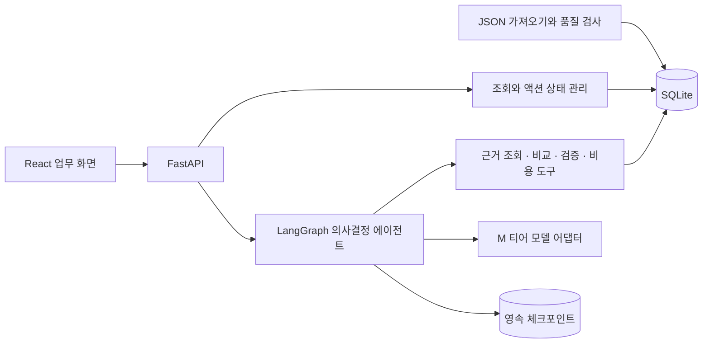

# VIVI 제품과 에이전트 설계

구현 전 초기 설계 기록이다. 현재 동작은 [에이전트 설계](agent-design.md), 실제 호출과 검증 결과는 [비용 절감 결과](cost-optimization-results.md)를 참고한다.

## 1. FDE 관점에서 해결할 업무

고객은 OrbitCRM의 마케팅 담당자다. 주어진 75개 질문과 3개 AI 채널에서 자사가 어떻게 나타나는지는 볼 수 있지만, 어떤 내용을 고쳐야 하는지와 무엇부터 실행해야 하는지 판단하기 어렵다.

제품의 목표는 **담당자가 근거를 확인하고 이번 주에 실행할 액션 1~3개를 선택하는 것**이다. FDE 관점의 설계 단위는 사용자의 업무 흐름, 실제 데이터의 한계, 운영 원가, 완료 여부를 판단할 기준이다.

| 사용자의 질문 | 제품이 제공할 답 |
| --- | --- |
| 어디부터 볼까? | 중요도·경쟁사 대비 격차·데이터 커버리지가 드러나는 주제 목록 |
| 왜 이 주제인가? | 채널별 실제 답변, 브랜드 언급, 인용 출처, 비교 가능한 이전 관측 |
| 무엇을 바꿀까? | 근거에 연결된 진단 가설, 구체적인 액션, 실행 단계, 완료 조건 |
| 지금 실행해도 될까? | 근거 충분성, 추가 확인 사항, 이미 진행 중인 관련 액션 |
| 그다음에는? | 진행 상태 저장, 다음 수집에서 확인할 지표와 재검토 조건 |

액션 완료가 AI 가시성 향상을 입증하지는 않는다. 제공 데이터는 액션 실행 전후 실험이 아니므로 효과의 인과를 주장하지 않는다.

## 2. MVP 범위

첫 구현은 한 고객·한 대상 브랜드(BR001), 제공된 질문·주제·채널, 수동 액션 관리에 집중한다. 주제 단위 분석은 해당 주제의 5개 질문과 3개 채널을 함께 다룬다. 채널·질문 필터는 같은 분석의 근거를 좁혀 보는 기능이다.

| 필수 요구사항 | 구현 위치 |
| --- | --- |
| 분석 데이터 목록·상세 | 주제 목록 → 질문별 관측과 원문 상세 |
| 검색·필터·정렬 | 질문 검색, 채널·주제 필터, 기회 점수 정렬 |
| 액션 생성·조회·상태 변경 | 에이전트 제안 검토 → DB 저장 → 액션 보드 |
| 재시작 후 유지 | 파일 SQLite DB와 마이그레이션, 재시드 시 액션 보존 |
| 실제 API 연동·입력 검증 | FastAPI/Pydantic, 프론트 서버 상태 관리 |
| 로딩·빈 상태·오류 | 목록·분석 실행·저장 각각의 상태 표시 및 재시도 |
| 자율 문제 해결 기능 | 근거 기반 우선순위와 `추가 확인`·`유지 관찰` 판단 |
| 원가·품질 검증 | 고정 단가 계산기, 실행 원장, 오프라인 평가 시나리오 |

후속 범위는 자유 프롬프트 분석, 실제 AI 검색 수집, 외부 콘텐츠 발행, 고객별 인증·권한, 다중 고객 운영이다. 이 범위를 추가하면 분석 키와 비용 모델도 다시 검증한다.

## 3. 화면 구성

화면의 기본 단위는 담당자가 검토할 주제와 액션이다. 에이전트 실행 정보는 분석 진행 상태와 결과의 근거로 보여준다.

```text
VIVI / OrbitCRM                        데이터 기준일 · 유효 관측 커버리지

[개선 기회]  [액션 보드]

질문 검색                 채널 필터               정렬: 기회 점수
┌──────────────────┬──────────────────────────────────────────────┐
│ 주제 목록        │ 선택한 주제의 근거                           │
│                  │                                              │
│ 주제명           │ 자사·경쟁사 추천 비율 / 비교 표본 수          │
│ 격차 · 중요도    │ 질문 목록 → AI 답변 원문 / 인용 출처         │
│ 커버리지         │ 이전 수집과의 비교 / 제외 데이터와 이유       │
│ 검토 상태        │                                              │
│                  │ [분석하기]                                   │
│                  │ 관측 사실 → 진단 가설 → 추천 액션            │
│                  │ 근거 · 실행 단계 · 완료 조건 · 재확인 지표    │
│                  │ [액션 검토 후 저장]                          │
└──────────────────┴──────────────────────────────────────────────┘

액션 보드: 할 일 → 진행 중 → 완료 / 보류
액션 상세: 근거·수정 가능한 초안·상태 이력·다음 검증 조건
```

첫 화면에는 사전 집계한 기회 점수를 보여주며 아직 실행하지 않은 에이전트 분석은 `미분석`으로 표시한다. 분석 결과의 `개선 제안`·`유지 관찰`·`추가 확인`을 미리 생성된 사실처럼 표시하지 않는다.

“수집 실패”는 브랜드 미언급과 구별한다. 표본이 없는 비율은 0% 대신 `계산 불가`다. 모든 비율에는 유효 표본 수와 대상 기간을 붙인다. 합성 출처의 `.example` URL은 원본 식별자로 보여주며 실제 페이지를 가져오지 않는다.

## 4. 시스템 경계



React는 표시·입력·서버 상태를 담당한다. API는 요청 검증과 실행·저장 계약을 담당한다. **의미 판단, 개선 필요성, 진단, 액션 선택은 에이전트에 둔다.** 수치 집계, 근거 ID 검증, 상태 전이, 예산 계산은 일반 코드로 구현해 에이전트가 도구·노드로 사용한다.

LangGraph는 결정적인 단계와 모델 판단을 한 그래프에 둘 수 있다. 이 구조에서는 비즈니스 정책을 프론트와 API 라우트에 중복 구현하지 않는다. [LangGraph 공식 개요](https://docs.langchain.com/oss/python/langgraph/overview)

초기 기술 선택은 React·TypeScript·Vite, FastAPI·Pydantic, LangGraph Python, SQLite다. UI 서버와 Python API를 개발 프로세스로 두고, 배포 시에는 빌드된 프론트를 API와 함께 제공할 수 있다. 버전은 실제 구현 시 호환성을 확인해 lockfile로 고정한다.

## 5. 데이터 처리 정책

원본 테이블은 그대로 보존하고, 분석용 canonical observation과 제외 이유를 별도로 만든다. 아래 정책은 실제 데이터 감사 스크립트와 맞춘다.

1. 관측을 `(question_id, channel, source_snapshot_id)`로 묶는다. 스냅샷 ID가 없으면 수집일 기준 fallback을 기록하고 확인 대상으로 둔다.
2. 재수집 중복은 수집 상태, 질문과의 언어 일치, 최신 수집시각, observation ID 순으로 대표를 정한다. 원본과 대체된 ID를 보존한다.
3. 기본 비율의 분모는 대표 관측 중 `complete`이고 질문 언어와 일치하는 응답이다. partial·failed·언어 불일치는 근거 상세에서 보되 비율에서 제외한다.
4. 언급·추천 여부는 `mentions`, 인용은 `citations`와 `sources`로 계산한다. observation의 편의용 요약 컬럼은 검산 대상이다.
5. 브랜드별 비율은 해당 브랜드가 등장한 서로 다른 유효 관측 수를 센다. 한 답변에서의 중복 언급으로 분자를 늘리지 않는다.
6. 출처 소유 브랜드가 없으면 `미상`으로 남긴다. 도메인에서 추정한 소유자는 원본 사실과 분리하며 자동으로 자사 공식 출처 비율에 더하지 않는다.
7. 시점 간 변화는 두 시점 모두 유효한 `(question_id, channel)` 쌍으로 비교한다. 전체 커버리지 변화도 함께 표시한다.
8. 의미가 비슷한 질문을 임의로 합치지 않는다. MVP의 분석 단위는 제공된 topic_id다.

감사에서 확인된 주요 수치는 원본 456건, 중복 정리 후 450건, 기본 분석에 사용 가능한 관측 430건이다. 최신 수집의 유효 관측은 212건이며, 그중 실제 자사 언급은 63건이다. 자세한 제외 목록과 계산 결과는 [데이터 감사](data-audit.json)에 보존한다.

사례상 보안 주제에서는 자사 언급이 없어도 자사 공식 출처가 인용된다. 따라서 관측으로 확인할 수 있는 “브랜드가 추천되지 않는다”와 검증이 필요한 “공식 문서가 부족하다”를 구별해야 한다. 출처 본문이 제공되지 않았으므로 실제 콘텐츠 결함은 가설로만 제시한다.

초기 데모는 다음 세 경우를 중심으로 구성한다. 표의 방향은 데이터에서 도출한 설계 가설이며 실제 에이전트를 실행한 결과가 아니다.

| 주제 | 최신 데이터의 사실 | 기대하는 에이전트 분기 |
| --- | --- | --- |
| 리드 관리 | 자사 언급 5/15, Perplexity에서는 0/5, 같은 채널 5개 응답 모두 경쟁사 출처 SRC025 인용 | 경쟁사의 리드 배정 콘텐츠를 비교할 액션 제안과 검증 계획 |
| 업무 자동화 | 유효 관측 15/15에서 자사 추천 | 유지 관찰, 불필요한 개선 액션 생략 |
| 확장성 | 기대 관측 15개 중 유효 9개, failed 3개·partial 3개 | 추가 수집 우선, 실패를 미언급으로 해석하지 않기 |

## 6. 액션 품질을 책임지는 에이전트

핵심 기능은 분석 데이터에서 실제 개선할 작업을 만드는 것이다. 판단 단계와 출력 계약은 [액션 에이전트 설계](action-agent.md)에 정의한다. 그래프·API·저장 구조는 이 판단을 실행하고 검토할 기반이다.

```text
정제된 근거 + 고객 맥락
→ 기회·원인 가설 판단(M)
→ 필요한 로컬 근거 조회
→ 대안 비교·실행 브리프 작성(M)
→ 수치·참조 검사
→ 의미와 실행 가능성 평가(M)
→ 통과: 추천 / 유지 관찰 / 추가 확인
→ 탈락: 수정(M) → 재검사·재평가(M), 미달이면 검토 필요
```

좋은 액션은 근거와 작동 가설, 변경할 대상, 산출물 내용·초안, 담당 역할과 선행 조건, 완료 기준과 효과 확인 방법을 갖춘다. 근거 ID가 유효하거나 JSON 형식이 맞다는 이유만으로 좋은 추천이라고 판단하지 않는다.

코드는 정제·집계·참조 검사·상태 전이·예산 계산을 맡는다. 에이전트는 문제와 처방을 연결하고 대안을 비교한다. 별도 의미 검토 호출은 근거 적합성·문제와 처방의 연결·구체성·실행 가능성·검증 가능성을 평가한다. 같은 모델의 별도 호출이 독립적인 정답 판정자는 아니므로 사람의 오프라인 평가도 수행한다.

초기 통과 정책은 5항목 각 0~2점, 합계 8점 이상, 모든 항목 1점 이상, 필수 위반 0건이다. 존재하지 않는 근거, 틀린 집계, 근거 없는 제품 기능·인과 단정, 게시를 막는 선행 조건 누락은 필수 위반이다. 점수는 선택 정책이며 성공 확률이 아니다.

기본 경로는 M 3회이고 수정·재평가를 한 번 더 허용해 **분석 키당 유료 시도는 최대 5회**다. 통신 재시도·응답 유실·재개도 같은 한도를 사용한다. 수정과 재평가에 필요한 2회 비용을 함께 예약하며, 검토하지 않은 수정안을 통과 결과로 반환하지 않는다. 예산이 부족하거나 재평가도 실패하면 `review_required`로 끝낸다.

```text
AgentState
  run_id, tenant_id, target_brand_id, topic_id
  snapshot_id, dataset_hash, business_context_hash
  policy_version, prompt_version, model_version
  evidence_pack, verified_product_facts, asset_metadata
  diagnosis, evidence_requests, action_candidates, selected_actions
  review_findings, validation_errors, paid_attempts, usage_receipts

AnalysisBundle
  decision: recommend | observe | needs_data | review_required
  facts[], hypotheses[], counterevidence[]
  candidates[]: ActionBrief
  rejected_alternatives[], review_result, limitations[]
  generated_at, snapshot_id, business_context_hash
```

고객 맥락에는 확인된 제품 기능·보유 자산·사업 목표·제약을 넣는다. 제공되지 않은 값은 unknown으로 유지한다. 문서 본문이나 기능 지원이 확인되지 않아도 초안과 확인표는 만들 수 있으며, 미확인 기능 주장과 게시 단계는 확인 결과에 따르게 한다. 모든 후보는 준비 가능한 작업과 막힌 단계를 구별한다.

목록 정렬용 기회 점수는 `100 × 평균 중요도/100 × max(0, 최고 경쟁사 추천 비율 - 자사 추천 비율) × 커버리지`로 시작한다. 모든 브랜드의 분모는 동일한 유효 관측이다. 이 점수는 탐색 순서를 돕는 초기 정책이며 최종 액션의 가치를 대신하지 않는다. 기존 자산의 재사용, 고객이 통제할 수 있는 변경, 필요한 노력과 불확실성은 에이전트의 후보 비교에 포함한다.

주제 커버리지 80%·각 채널 3개 이상이라는 초기 기준은 전체 주제 진단의 범위를 정하는 정책이다. 기준 미달이면 전체 결론을 제한하고 필요한 수집을 명시한다. 충분한 표본이 있는 좁은 범위를 다룰 때는 그 범위와 한계를 표시한다. 통계적 유의성을 보장하는 기준은 아니다.

같은 데이터라도 고객 맥락이 바뀌면 캐시를 갱신한다. 액션의 현재 진행 상태는 묶음에 고정하지 않고 반환 시 DB에서 다시 조회해 중복 작업을 막는다.

## 7. 저장과 API 계약

| 저장 단위 | 주요 내용 |
| --- | --- |
| 제공된 6개 원본 테이블 | brands, questions, observations, mentions, sources, citations |
| canonical 관측·품질 이슈 | 대표 ID, 제외·보정 이유, 정책 버전 |
| analysis_runs | 실행 상태, 요청 키, graph thread ID, 오류, 시작·완료 시각 |
| analysis_bundles | 스냅샷·주제별 검증된 진단과 액션 후보, 모델·정책 버전 |
| actions | 선택한 후보, 사용자 수정본, 상태, 원본 분석 참조, version |
| action_events | 상태 변경 전후, 시각, 변경 이유 |
| usage_ledger | 호출 종류·티어·시도·예약·정산 상태·환산 비용 |
| LangGraph checkpoints | 중단된 실행의 상태, 비즈니스 액션과 별도 영속화 |

액션과 상태 이력은 한 DB 트랜잭션으로 저장한다. `todo → in_progress → done`을 기본으로 하고 `on_hold`, 재개·재오픈을 명시적으로 허용한다. 낙관적 잠금의 version이 다르면 409를 반환한다.

LangGraph에는 파일 기반 checkpointer와 안정적인 thread_id를 사용한다. 체크포인트와 actions 테이블은 역할이 다르다. RAM 기반 체크포인터는 프로세스 재시작 시 상태를 잃는다. [공식 영속화 문서](https://docs.langchain.com/oss/python/langgraph/persistence)

모델 호출과 결과 저장에는 고유한 실행·단계·시도 ID를 붙인다. 결과가 이미 저장된 단계는 재사용한다. 호출 응답 직후 프로세스가 종료되어 결과를 기록하지 못한 경우에는 과금 여부가 불명확할 수 있으므로 비용 예약을 보수적으로 유지한다. 체크포인트만으로 외부 호출의 exactly-once를 보장한다고 가정하지 않는다.

| API | 역할 |
| --- | --- |
| `GET /api/topics` | 주제 목록, 사전 집계 지표, 데이터 품질, 정렬 |
| `GET /api/topics/{id}` | 채널·질문별 근거와 최신 분석 존재 여부 |
| `GET /api/observations/{id}` | 응답 원문, 언급, 인용, 품질 이슈 |
| `POST /api/analyses` | topic_id + snapshot_id 분석, 유효한 기존 묶음 재사용 |
| `GET /api/analyses/{id}` | 저장된 결과, 기준 데이터, 실행 상태 |
| `POST /api/analyses/{id}/resume` | 실패·중단 지점에서 동일 실행 재개 |
| `POST /api/actions` | 검증된 후보를 사용자 수정과 함께 액션으로 저장 |
| `GET /api/actions` | 상태별 액션 목록 |
| `PATCH /api/actions/{id}` | 상태·사용자 편집·version 검증 및 이력 저장 |

분석 API의 `{id}`는 실행의 `run_id`다. 성공 응답에는 재사용 가능한 결과의 `bundle_id`도 반환한다. 액션은 bundle과 candidate를 참조한다. 동일 분석 키의 동시 요청은 DB 유니크 제약과 실행 상태 확인으로 하나의 실행을 공유한다.

MVP 분석 실행은 동기 응답과 명확한 로딩 표시로 시작한다. 실행 ID는 호출 전에 DB에 저장하고 요청 키로도 찾을 수 있게 한다. 화면 재진입이나 응답 유실 시 동일 Idempotency-Key로 재요청해 기존 실행을 찾는다. 서버 재시작 시 미완료 실행을 `interrupted`로 식별하고 사용자 재시도로 재개한다. 나중에 별도 worker로 옮길 때도 같은 실행 계약을 유지한다.

생성 요청은 Idempotency-Key를 받는다. 같은 키·다른 입력은 409, 존재하지 않는 대상은 404, 입력 오류는 422, 예산 소진은 429와 구조화된 사유, 모델 장애는 503으로 응답한다. 오류 응답은 `{code, message, retryable, run_id?}`를 따른다. 예산 소진·모델 실패를 성공한 새 분석으로 기록하지 않는다.

동일 후보의 중복 저장은 `(tenant_id, analysis_bundle_id, candidate_id)` 유니크 제약으로 막는다. 다음 스냅샷의 유사 액션은 `(brand, topic, action_type, target)` 기반 fingerprint로 진행 중인 액션과 비교해 사용자에게 알려준다.

## 8. 비용과 품질

과제 기준 원가는 고객당 월 `1000 × (0.018 + 0.012) + 225 × 4.3 × 0.004 + 6 = $39.87`, 마진은 60.13%다.

수정된 에이전트는 의미 검토를 포함해 기본 M 3회를 사용한다. 제공 데이터의 집계·근거 조회에는 외부 분석 API가 필요하지 않다. 한 주제의 분석 묶음에 세 채널과 다섯 질문을 담아 재사용한다.

```text
분석 키 = tenant + brand + topic + snapshot + dataset_hash
          + business_context_hash + policy_version + prompt_version + model_version

월 평균 분석 묶음 = 15 × 4.3 = 64.5
월 모델 호출 = 64.5 × 3 = 193.5회
월 원가 = 모델 193.5 × $0.018 + 수집 $3.87 + 인프라 $6
        = $13.353 / 고객
매출총이익률 = 86.647%
```

5회 수집하는 달에 75개 묶음이 모두 수정·재평가를 포함해 5회씩 호출하면 모델 $6.75 + 수집 $4.50 + 인프라 $6 = **$17.25**, 마진 82.75%다. 이 계산은 기본 3회와 추가 2회의 공유 한도가 지켜질 때의 시나리오다.

월 전체 M 호출은 `min(500, 실제 남은 예산으로 가능한 호출 수)`로 제한한다. 수집·인프라 비용을 먼저 예약하고, 실패 과금·재시도·사전 계산·검토 호출도 전부 원장에 포함한다. 기본 실행과 수정·재평가 전에 필요한 비용을 원자적으로 예약한다. 사용하지 않은 예약은 해제하고, 과금 여부가 불명확하면 확인 전까지 유지한다.

64.5와 193.5는 장기 평균이며 실제 월의 실행 수는 정수다. 비용 계산은 15개 주제와 고객 맥락·버전이 고정돼 있고, 같은 분석 키의 동시 실행을 합치며, 필터가 새 분석을 만들지 않는 조건이다. 최초 과거 스냅샷 분석, 기능 확인 결과나 본문 추가, 정책·모델 변경, 추가 브랜드·질문, 강제 재생성은 별도 비용을 발생시킨다.

고객 수만 늘면 과제 가정에서 매출과 원가가 함께 늘어 마진은 유지된다. 고객당 요청 증가에도 같은 범위의 결과를 재사용하면 모델 호출은 유지된다. 분석 범위나 고객 맥락 변경이 증가하면 이 결론은 성립하지 않는다. 실제 캐시 적중률·처리 용량·지연은 구현 후 검증한다. [비용 시나리오](cost-projection.json)는 가정에 따른 계산이며 실제 실행 측정값이 아니다.

진단과 액션 작성에는 과제의 M 티어 가상 지표 81% 진단 정확도·68% 액션 채택률을 각각 적용한다. 후보 선택·검토는 가장 가까운 액션 판단 작업의 품질 가정을 참고하되, 검토를 추가했을 때의 실제 향상률은 알려져 있지 않다. 검토 모델도 틀릴 수 있으며 각 수치를 곱해 종합 성공률로 만들지 않는다. 두 호출 구조와 세 호출 구조의 실제 출력은 같은 평가 사례에서 비교한다.

주간 수집의 과제상 평균 변화 감지 지연은 3.5일이다. 새 스냅샷과 고객 맥락 변경 때 캐시를 무효화하고, 새 결과가 준비되지 않았으면 이전 결과의 기준일을 표시한다. Mock도 호출 환산 비용을 기록하지만 추천 품질의 증거로 사용하지 않는다. 별도 분류·임베딩·평가 모델을 더 쓰면 해당 호출도 비용에 포함한다.

## 9. 검증 기준

| 검증 | 성공 기준 |
| --- | --- |
| 핵심 사용자 흐름 | 목록 → 원문 상세 → 분석 → 액션 저장 → 상태 변경 → 새로고침·서버 재시작 후 유지 |
| 품질 문제 처리 | 중복·failed·partial·언어 불일치가 분모에 잘못 들어가지 않고 원본에서 추적 가능 |
| 비교 | 두 시점의 같은 유효 질문·채널 집합으로 계산, 분모와 커버리지 표시 |
| 근거 연결 | 저장된 모든 후보의 evidence ID가 존재하고 범위가 일치, 완료 조건 포함 |
| 과도한 추천 방지 | 충분한 노출·부족한 데이터 시나리오에서 억지 액션 생성 방지 |
| 오류·저장 | 잘못된 입력·모델 실패·중복 요청·상태 충돌이 구조화된 오류와 일관된 DB 결과 생성 |
| 비용 | 고정 요청 trace의 호출 원장으로 재계산 가능, 재시도 포함, 예산 초과 호출 차단 |

제품 가설은 “근거와 실행 단계를 함께 보여주면 원시 표를 읽는 것보다 액션 선택이 빨라진다”이다. [평가 사례](../evals/action-cases.json)의 8개 시나리오에서 근거·처방·구체성·실행성·검증 계획을 사람의 rubric으로 평가한다. 초기 목표는 8개 중 7개 이상에서 기대 판단 충족, 필수 위반 0건, 반복 저장 0건이다. 현재는 평가 사례를 정의한 상태이며 실제 모델 실행 결과는 없다.

사용성 목표는 담당자가 5분 안에 근거를 설명할 수 있는 액션 한 개를 저장하는 것이다. 현재는 목표이며 실제 사용자 실험 결과가 아니다. 시나리오와 정답 기준을 모델 출력보다 먼저 정해 자기평가에 의존하지 않는다.

## 10. 구현 순서와 예상 구조

```text
apps/
  web/src/
    features/opportunities/       주제 목록과 근거 상세
    features/actions/             액션 보드와 편집
    lib/api/                      API 계약과 서버 상태
  api/app/
    api/                          입력·응답·오류 계약
    agent/graph.py                실행 경로와 분기
    agent/state.py                상태와 결과 스키마
    agent/nodes/                  근거·진단·작성·검증
    agent/tools/                  집계·조회·예산·저장 도구
    domain/                       지표·품질·상태 전이 정책
    adapters/models/              mock와 실제 모델 경계
    storage/                      ORM·마이그레이션·저장소
scripts/                          데이터 감사와 비용 재현
tests/                            도메인·그래프·API·핵심 흐름
docs/                             설계와 검증 근거
```

1. **에이전트 입력과 평가**: 정제된 evidence pack, 고객 맥락, 8개 평가 사례, 기대 액션 브리프를 고정한다.
2. **에이전트 자체 구현**: UI 없이 실행할 CLI와 LangGraph부터 연결한다. 진단·후보 작성·검토·수정 흐름을 구현하고 실제 모델 출력을 평가한다. Mock 검증과 추천 품질 평가는 구별한다.
3. **사용자 흐름 연결**: 검토 가능한 액션 브리프를 React·API에 연결하고 사용자가 수정·저장·진행 상태 관리할 수 있게 한다. 재시작 후 보존을 확인한다.
4. **운영 제약**: 캐시, idempotency, 영속 체크포인트, 호출 원장과 예산 차단을 연결한다. 비용 한도는 에이전트 어댑터 단계부터 적용하고 이후 영속화한다.
5. **제출 완성**: 오류·빈 상태, 핵심 흐름 검증, 품질·비용 replay, 한계와 로컬 실행 방법을 README에 기록한다.

과제 권장 6~8시간은 실제 구현의 시간 예산이다. 첫 구현의 우선순위는 근거에서 실행 가능한 액션을 만드는 판단의 품질, 사용자 흐름의 완결성, 데이터 보존, 재현 가능한 비용 검증 순서다.

## 참고 자료

- 저장소 루트의 버블쉐어 개발자 과제전형 PDF, 필수 기능·비즈니스 제약·제출 조건.
- [제공 데이터 설명](../VIVI_MVP_Sample_Dataset/README.md), 데이터의 합성 성격·컬럼 의미·주의 사항.
- [고정 단가와 품질 가정](../VIVI_MVP_Sample_Dataset/pricing_assumptions.json).
- [LangGraph 개요](https://docs.langchain.com/oss/python/langgraph/overview), 결정적 노드와 모델 노드의 조합.
- [LangGraph 영속화](https://docs.langchain.com/oss/python/langgraph/persistence), 체크포인트의 역할과 저장 방식.
